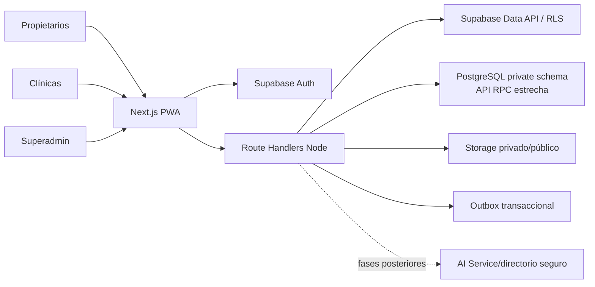

# VetIA — Arquitectura técnica

**Versión:** Consolidación aprobada para implementar Fase 1.  
**Fuente funcional:** `VETIA_PRD.md` v1.0.  
**Estado inicial:** el workspace estaba vacío antes de construir esta base.
**Revisión de infraestructura (2026-11-06):** Git `main` sincronizada con `origin/main`; `.env.local` existe y está excluido de Git. `pnpm exec supabase --version` devuelve 3.0.0. La URL Supabase Cloud y la clave publishable alcanzan Auth (HTTP 200), pero no se verificó PostgreSQL. La CLI no tiene sesión (`SUPABASE_ACCESS_TOKEN` ausente), por lo que el proyecto no está enlazado desde CLI y no se consultó ni modificó el historial remoto. No hay literales de claves secretas en archivos versionados. Nunca se muestran valores de entorno en este documento.

## 1. Stack

- Next.js App Router, React, TypeScript, Tailwind CSS.
- Supabase Auth, PostgreSQL y Storage.
- `@supabase/ssr` para cookies PKCE en Next.js.
- `@supabase/supabase-js` para Data API con RLS.
- Vercel Node runtime para Next; endpoints route handlers; no Edge runtime para acceso TCP a PostgreSQL.
- PWA instalable con shell estático; no cachear datos privados.
- Un proveedor de IA configurable en futura fase; no se implementa en Fase 1.

Next.js App Router admite Route Handlers. Supabase SSR usa cookies y PKCE. La clave secreta/service role omite RLS: no se usa como cliente general ni desde navegador. Fuentes: [Next.js App Router](https://nextjs.org/docs/app), [Supabase SSR](https://supabase.com/docs/guides/auth/server-side), [RLS](https://supabase.com/docs/guides/database/postgres/row-level-security).

## 2. Decisiones previas a migraciones

### 2.1 `clinic_patients`

PK compuesta recomendada `(clinic_id, id)` con `id uuid` local único por conveniencia; además `UNIQUE(clinic_id, pet_id)` para una asociación vigente única por mascota/clínica. FK compuesta `(clinic_id, clinic_client_id) → clinic_clients(clinic_id,id)`. No usar `pet_id` global como PK ni exponerlo por API. `clinic_patients` puede incluir `global_pet_id` solo en schema privado/mapping backend; para evitar exposición y duplicación, preferir tabla de vínculos privada `private.clinic_pet_links` referenciada por ID local. La clínica opera sobre sus campos locales.

### 2.2 Correspondencias global/local

`owners` y `pets` en esquema `private` no expuesto a PostgREST. `clinic_clients` y `clinic_patients` almacenan fichas operativas locales. `private.owner_client_links` y `private.clinic_pet_links` guardan correspondencias, con PK/FK compuestas, acceso servidor únicamente. El backend transfiere campos permitidos tras validar sesión, tenant, relación/consentimiento y propósito. No se vincula por coincidencia de teléfono/nombre ni se comparte historial entre clínicas. No existe `pet_access_grants` en P0.

### 2.3 Next.js hacia esquema PostgreSQL privado

Las tablas privadas no se añaden a los schemas expuestos de PostgREST. Next.js accede a ellas mediante una **fachada RPC estrecha** en un schema expuesto, usando el cliente Supabase con sesión del usuario. Cada función verifica `auth.uid()`, membresía/propósito y AAL2 si corresponde; valida argumentos, devuelve solo columnas autorizadas y usa `SECURITY DEFINER SET search_path = ''` únicamente cuando necesita operar sobre objetos privados. Usa nombres calificados, `EXECUTE` explícito y permisos revocados por defecto. Preferir `SECURITY INVOKER` cuando sea posible. No añadir `private` a la configuración de schemas expuestos. Esto evita conexión de runtime con privilegios SQL amplios y no requiere service_role general ni `DATABASE_URL`.

Next Server Actions/Route Handlers verifican sesión con Supabase Auth y autorizan antes de llamar RPC. Operaciones críticas son funciones transaccionales específicas, nunca SQL arbitrario. Supabase Auth Admin puede usar una clave secreta solo desde backend y solo para invitaciones cuando esa fase llegue; no se configura para Fase 1.

### 2.4 Outbox serverless real

`outbox_events` se escribe en la misma transacción que la operación de dominio. Una RPC transaccional reclama evento/lote pequeño con `FOR UPDATE SKIP LOCKED`, establece `status=processing`, `lease_token` y `lease_expires_at`, e incrementa intentos. El serverless realiza el efecto externo y finaliza solo si su token sigue vigente. Un fallo actualiza `last_error`, programa `available_at` con backoff y libera lease; un crash deja lease que vuelve a ser reclamable al expirar. La aplicación invoca tras commit y superadmin puede reintentar. Para recuperación automática se podrá configurar Supabase Cron invocando función protegida tras verificar plan/secretos. No se presupone worker permanente ni se usa `waitUntil` como cola durable. Si no hay scheduler, quedan pendientes visibles hasta reintento por demanda/admin.

## 3. Entornos

Pública/propietarios, clínica, superadministración e IA. UI compone pantallas; Route Handlers controlan mutaciones e integraciones; PostgreSQL valida integridad/RLS; Supabase Auth aporta identidad; Storage aplica políticas propias. IA y servicios externos se añaden después de Fase 1.



## 4. Modelo de datos Fase 1

Todos los IDs UUID; timestamps UTC `timestamptz`; claves/estados validados; índices en FK y filtros tenant. No materializar P2 clínico.

### Público/app schema

- `profiles(user_id PK/FK auth.users, display_name, phone, timestamps)`: campos mínimos de cuenta, sin rol editable.
- No hay tabla pública de administradores; el rol está en `private.platform_admins(user_id PK/FK auth.users, created_at, created_by)`, con bootstrap controlado y sin signup de rol.
- `clinic_applications(id PK, submission_key UNIQUE, applicant_user_id NOT NULL, business_name, city, contact_name/email/phone, submission_status, submitted_at, decision_message, reviewed_by, reviewed_at, timestamps)`. Las notas internas están separadas en `private.application_reviews`.
- `clinics(id PK, application_id NOT NULL UNIQUE FK, slug UNIQUE, public profile fields, lifecycle_status, profile_status, publication_status, approved_at/by, timestamps)`. Publicación independiente de aprobación.
- `clinic_memberships(clinic_id,user_id PK compuesta, role, status, invited_by, timestamps)`. Roles allowlist.
- `clinic_clients(clinic_id,id, local contact fields, timestamps, PK(clinic_id,id))`.
- `clinic_patients(clinic_id,id,clinic_client_id, local basic pet fields,status,timestamps, PK(clinic_id,id), UNIQUE(clinic_id,clinic_client_id,id))`; FK compuesta al cliente.

### Schema privado no expuesto

- `private.owners(id PK, user_id nullable UNIQUE, full_name, phone, email, timestamps)`.
- `private.pets(id PK, owner_id nullable FK, name, species, basic fields, timestamps)`.
- `private.owner_client_links(clinic_id, clinic_client_id, owner_id, linked_by, linked_at, consent_basis, PK(clinic_id,clinic_client_id), FK compuesta a cliente)`.
- `private.owner_client_links` también tiene `UNIQUE(clinic_id,owner_id)` para impedir más de una correspondencia global/local por persona en una clínica.
- `private.clinic_pet_links(clinic_id, clinic_patient_id, pet_id, linked_by, linked_at, consent_basis, PK(clinic_id,clinic_patient_id), FK compuesta a paciente)`.
- `private.clinic_invitations(id,clinic_id,email_normalized,role,token_hash,status,expires_at,accepted_user_id,invited_by,timestamps)`; índice único parcial para una invitación pendiente por clínica/correo.
- `private.platform_admins(user_id PK,created_at,created_by)` y `private.application_reviews(id,application_id,reviewer_user_id,action,internal_notes,created_at)`.
- `private.audit_events(id,actor,clinic_id,action,entity,reason,metadata,created_at)`, append-only por aplicación.
- `private.outbox_events` está en `private` y se detalla abajo.

Correspondencia privada no implica acceso de clínica a fila global ni historial de otra clínica. La Fase 1 no crea historia clínica avanzada.

### Integridad tenant

Agregar `UNIQUE(clinic_id,id)` en tablas padre y FKs compuestas hijas: `(clinic_id,clinic_client_id) → clinic_clients(clinic_id,id)`; `(clinic_id,clinic_patient_id) → clinic_patients(clinic_id,id)`; en vínculos privados, mismo patrón; todas las tablas hijas de citas en fases posteriores incluirán `(clinic_id,appointment_id) → appointments(clinic_id,id)`. Integridad la impone PostgreSQL aunque API/RLS falle.

## 5. Grants, RLS y columnas

- RLS habilitada en toda tabla expuesta; grants SQL mínimos por rol. Revocar permisos tabla amplios antes de otorgar operaciones específicas.
- `private` excluido de schemas expuestos; sin grants Data API a sus tablas.
- RPC que atraviesan `private`: funciones acotadas, validan `auth.uid()`/membresía/AAL2, argumentos permitidos y devuelven la mínima información. Usan `search_path=''`, nombres calificados, `EXECUTE` explícito y `SECURITY DEFINER` solo donde se necesita elevar acceso. No reciben identidad o rol como autoridad desde el cliente.
- `profiles`: SELECT propio; UPDATE solo `display_name` y `phone`; nunca `user_id`; fila creada por trigger Auth.
- `platform_admins`: privado; bootstrap único por propietario de proyecto; el cliente solo puede consultar su propio booleano mediante RPC. Toda operación admin exige AAL2.
- `clinic_applications`: SELECT propio o superadmin AAL2 sobre columnas explícitas; INSERT solo mediante RPC autenticada e idempotente; sin UPDATE/DELETE directos. Notas internas privadas.
- `clinics`: sin SELECT/INSERT/UPDATE/DELETE directo por Data API en Fase 1; Fase 2 expondrá vista con columnas permitidas.
- `clinic_memberships`: SELECT propia, roster al administrador del tenant o superadmin AAL2; sin INSERT/UPDATE/DELETE directo.
- `clinic_clients`/`clinic_patients`: SELECT/INSERT/UPDATE del tenant activo; columnas allowlist; sin DELETE; FK compuestas evitan referencias cross-tenant.
- `private.owners`/`private.pets`: RLS activa, sin grants de tabla; propietario solo por RPC self-scoped; sin acceso directo desde clínicas.
- `private.owner_client_links`/`clinic_pet_links`: sin acceso de cliente; escritura futura por RPC tras autorización/consentimiento.
- `private.clinic_invitations`, `application_reviews`, `audit_events` y `outbox_events`: sin grants Data API; operaciones futuras mediadas por transacciones/RPC y autorización administrativa.
- Storage mantiene políticas independientes por bucket/path; documentos privados no usan bucket público.
- Toda decisión privilegiada se valida también en servidor; RLS no es sustituto de autorización del endpoint.

| Fase 1 | Lectura | Inserción | Modificación | Eliminación |
|---|---|---|---|---|
| `profiles` | Propio | Trigger de Auth | Campos de perfil permitidos, fila propia | No |
| `clinic_applications` | Solicitante propio o superadmin AAL2, columnas explícitas | RPC propia, email confirmado | No directa | No |
| `clinics` | No directa; futura vista pública segura | No directa | No directa | No |
| `clinic_memberships` | Propia/roster autorizado | No directa | No directa | No |
| `clinic_clients`/`clinic_patients` | Tenant activo | Tenant activo | Tenant activo, columnas permitidas | No |
| `private.owners`/`private.pets` | Solo funciones self-scoped | Funciones self-scoped | Solo propietario de sesión | No directa |
| Tablas privadas operativas | No directa | Proceso/RPC autorizado | Proceso/RPC autorizado | No desde cliente |

RLS define filas y grants PostgreSQL definen tablas/columnas. Se revocan permisos generales y se conceden columnas explícitas; las vistas públicas futuras tendrán proyección propia y no expondrán tablas administrativas.

### RPCs implementadas en Fase 1

- `public.vetia_is_platform_admin()` devuelve solo si el usuario actual tiene rol admin; no concede acceso.
- `public.vetia_submit_clinic_application(...)` exige usuario y correo confirmados, fija solicitante desde `auth.uid()` y evita duplicados por `submission_key`.
- `public.vetia_upsert_my_owner(...)` crea/actualiza solo el titular ligado a la sesión.
- `public.vetia_list_my_pets()` devuelve columnas explícitas de mascotas propias.
- `public.vetia_create_my_pet(...)` crea mascota para el titular de sesión y no acepta `owner_id` externo.
- `private.is_platform_admin()` requiere AAL2; `private.is_clinic_member()` determina tenant/rol activo; `private.handle_new_auth_user()` crea perfil mínimo.

## 6. Autenticación y autorización

Supabase Auth email/password, confirmación, recuperación y logout. `@supabase/ssr`, cookies HTTPOnly/Secure/SameSite y PKCE. Validar claims de forma server-side; proxy/middleware solo optimiza redirects, no es barrera de autorización única. Solicitantes pendientes no tienen membresía operativa. Invitación es de un uso, hash, expiración, email y clínica/rol fijados. Propietario sin rol editable; clínica adquiere rol solo por invitación/aprobación. Primer superadmin provisionado manualmente desde entorno confiable/Dashboard y DB migration/secret procedure auditada; no alta pública.

### MFA

TOTP obligatorio para superadmins; enrolar y verificar antes de habilitar operación. Comprobar JWT `aal2` en páginas/API y RLS restrictiva para recursos/operaciones administrativas. Exigir MFA reciente/reautenticación para cambios de rol, aprobación/publicación, suspensión y cambios de secreto/usuario. No asumir recovery codes de Supabase. Recuperación manual: verificar identidad por responsables, dos aprobadores cuando viable, revocar factor/sesiones, registrar incidente, re-enrolar TOTP; sin bypass AAL1. Cuenta de emergencia solo bajo custodia controlada y auditoría posterior.

## 7. Directorio

Fuente pública única: vista/RPC de columnas permitidas sobre clínica aprobada, activa, perfil completo y publicada. Rutas del directorio y futura herramienta IA consumen esa misma fuente. Ninguna tabla de solicitud, membership, documento o plan se expone públicamente. Horarios declarativos, no disponibilidad.

## 8. Outbox

Campos: `id`, `event_type`, `aggregate_type`, `aggregate_id`, `idempotency_key`, `payload`, `status`, `attempts`, `available_at`, `lease_token`, `lease_expires_at`, `processed_at`, `last_error`, `created_at`. `idempotency_key UNIQUE`; `attempts CHECK >= 0`; `processing` requiere lease; `processed` requiere fecha. Índices parciales `(available_at,created_at)` para pending/failed, `(lease_expires_at,created_at)` para leases en processing y `(aggregate_type,aggregate_id,created_at)`. Payload versionado, limitado y sin secretos/PII innecesaria.

Worker serverless corto por lote, `SKIP LOCKED`, invocación bajo demanda más scheduler configurado/verificado si existe. Backoff, máximo de intentos, estado `dead`, sanitización de error. Retry admin reusa idempotency key y requiere auditoría. Ningún proceso permanente supuesto.

## 9. Estructura modular

```text
src/app/(public)/, (owner)/, (clinic)/, (admin)/, api/v1/
src/features/{auth,tenancy,applications,owners,pets,admin}/
src/lib/supabase/{browser,server,proxy}.ts
src/lib/auth/, authorization/, validation/
src/server/{db-private,services,repositories,policies,audit,outbox}/
supabase/migrations/, tests/, config.toml
```

`db-private` debe ser `server-only` y runtime Node; UI no contiene SQL ni secretos. No crear módulos de fases futuras hasta necesitarlos.

## 10. Variables de entorno por nombre (sin valores)

Browser: `NEXT_PUBLIC_SUPABASE_URL`, `NEXT_PUBLIC_SUPABASE_PUBLISHABLE_KEY`. No se necesita `DATABASE_URL` para runtime; privado se opera por RPCs estrechas con sesión. Auth Admin podrá usar `SUPABASE_SECRET_KEY` solo al implementar invitaciones, desde backend aislado. Para Supabase Cloud, ejecutar `pnpm exec supabase login`, luego `pnpm exec supabase link --project-ref <project-ref>` y proveer la contraseña DB cuando se solicite. `SUPABASE_ACCESS_TOKEN`/`SUPABASE_DB_PASSWORD` deben mantenerse en un entorno seguro, nunca en archivos versionados. En la revisión del 2026-11-06 faltan token de acceso y contraseña DB; no se pudieron enlazar ni comparar migraciones remotas. La clave secreta Supabase no sustituye el token CLI ni la contraseña DB.

## 11. Pruebas de Fase 1

- Auth signup/confirm/login/reset/logout y cookie session; correo real requiere configurar SMTP/proyecto.
- Propietario no puede editar rol ni consultar perfil/owners/pets ajenos.
- Solicitante pendiente no tiene membership ni rutas operativas.
- Invitación no altera tenant/rol; duplicados y reintentos no duplican clínica/membership/invitation.
- AAL1 falla para admin; AAL2 permite operaciones autorizadas.
- Dos clínicas: lectura/escritura cross-tenant denegada por solicitudes autenticadas y SQL; FK compuesta rechaza vínculos incoherentes.
- `private` no aparece en schemas de Data API; sus tablas no tienen grants de cliente.
- TypeScript, lint, build, migraciones aplicadas en local y tests SQL/RLS; si falta Docker/credenciales, documentar bloqueo exacto sin declarar prueba aprobada.

## 12. Fuentes técnicas

- [Supabase SSR](https://supabase.com/docs/guides/auth/server-side)
- [Supabase Postgres serverless](https://supabase.com/docs/guides/database/connecting-to-postgres)
- [Supabase Column Level Security](https://supabase.com/docs/guides/database/postgres/column-level-security)
- [Supabase RLS](https://supabase.com/docs/guides/database/postgres/row-level-security)
- [Supabase MFA/AAL](https://supabase.com/docs/guides/auth/auth-mfa)
- [Supabase Database Functions](https://supabase.com/docs/guides/database/functions)
- [PostgreSQL constraints](https://www.postgresql.org/docs/current/ddl-constraints.html)
